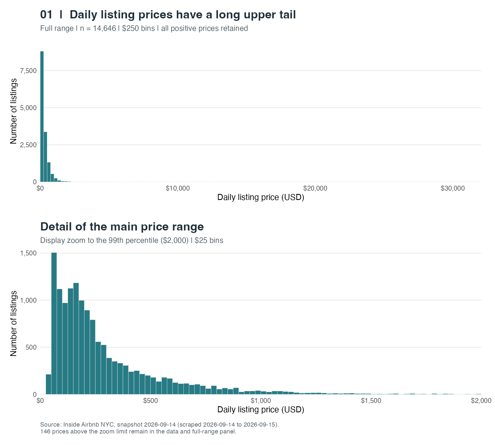
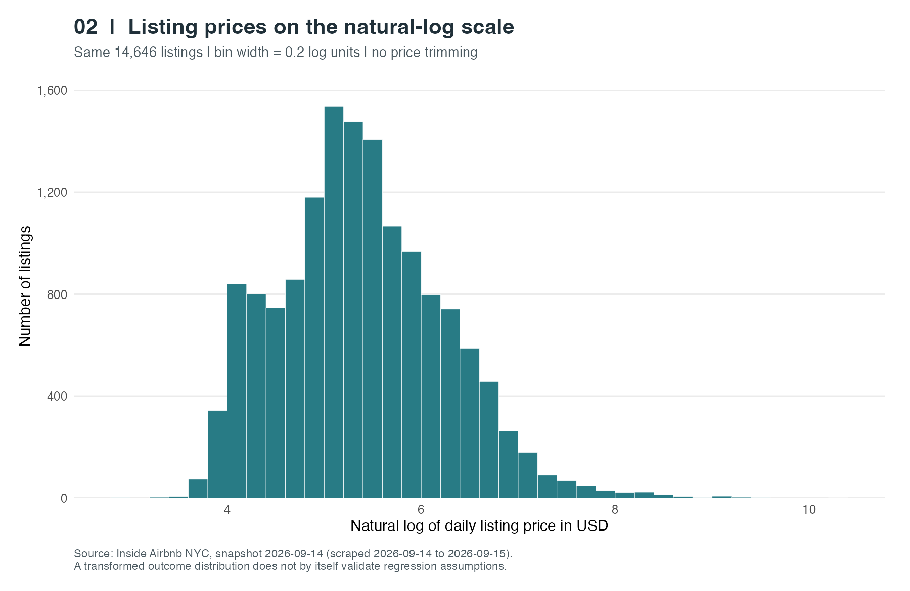
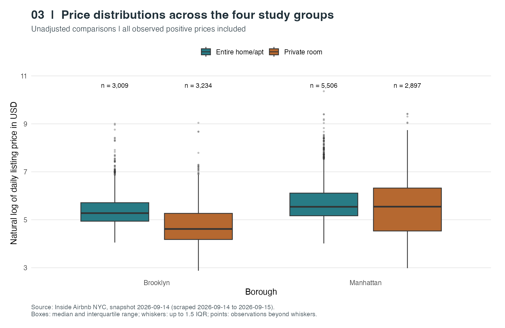
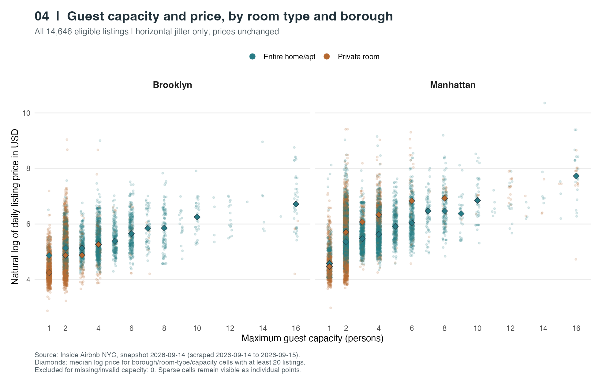

# Exploratory data analysis: NYC Airbnb listing prices

Generated entirely from the pinned source snapshot by `Rscript --vanilla scripts/04_generate_eda.R`.
All numerical statements, table files and figures are computed by R. This is descriptive analysis, not regression inference.

## Data and sample

Source: Inside Airbnb NYC, snapshot 2026-09-14 (scraped 2026-09-14 to 2026-09-15). The raw file contains 29,918 listings and 90 fields.
The scope is Manhattan/Brooklyn and Entire home/apt/Private room (23,440 listings). The EDA sample contains 14,646 listings with observed, finite, positive daily prices. No high-price trimming, imputation or subsampling is used.
Missing ratings/bedrooms do not exclude listings from price plots. Figure 4 additionally requires valid guest capacity.

## Price coverage and minimum-stay composition

8,794 scoped listings lack a price (37.5%). Positive-price coverage is not equal across the four groups:

- Brooklyn / Entire home/apt: 3,009 of 5,313 (56.6%).
- Brooklyn / Private room: 3,234 of 4,853 (66.6%).
- Manhattan / Entire home/apt: 5,506 of 8,922 (61.7%).
- Manhattan / Private room: 2,897 of 4,352 (66.6%).

These coverage differences limit generalization. A complete-case price analysis does not resolve selection from missing prices.
Within Manhattan Private room, median minimum stay is 3 nights for listings with observed positive prices and 30 nights for listings without usable prices. Thus price-observed and price-missing records differ on at least this observed characteristic; this does not identify the missing-data mechanism.

Among positive-price listings, the proportions requiring at least 30 nights are:

- Brooklyn / Entire home/apt: 2,610 / 3,009 (86.7%).
- Brooklyn / Private room: 2,259 / 3,234 (69.9%).
- Manhattan / Entire home/apt: 4,622 / 5,506 (83.9%).
- Manhattan / Private room: 1,359 / 2,897 (46.9%).
Minimum stay is missing/invalid for 6 positive-price listings; denominators above include these records.
The sample mixes minimum-stay regimes. It should not be described as exclusively short-stay accommodation; compare within stay groups before interpreting room-type differences.

## Property-type composition

Room type alone does not identify residential accommodation. Within Manhattan Private room listings with positive prices, 1,304 of 2,897 (45.0%) have property_type text containing hotel, hostel or resort (case-insensitive). This is a transparent text flag, not a verified business or legal classification. No such records were excluded from these plots.
The exact property labels and group counts are in property_type_composition.csv and property_label_classification.csv. A residential-scope sensitivity analysis should be considered before final modeling; room_type = Private room must not be described as exclusively a room in someone's home.

## Descriptive price statistics

Overall: median $204.70; mean $331.69; SD $558.39; range $17.70-$31537.82.

- Brooklyn / Entire home/apt: n = 3,009; median $195.53; Q1-Q3 $139.67-$302.13; mean $276.70; SD $355.30.
- Brooklyn / Private room: n = 3,234; median $101.01; Q1-Q3 $65.13-$193.54; mean $164.17; SD $256.33.
- Manhattan / Entire home/apt: n = 5,506; median $254.54; Q1-Q3 $175.13-$450.71; mean $411.00; SD $685.04.
- Manhattan / Private room: n = 2,897; median $256.00; Q1-Q3 $92.88-$556.10; mean $425.07; SD $651.99.

Group summaries describe observed prices without adjustment for capacity, bedrooms, minimum stay or other characteristics. They are not estimates of causal effects or tests of significance.

## Figure 1: raw prices

The mean exceeds the median and the full-range panel shows the long upper tail. The lower panel zooms to $2000.00 (the sample 99th percentile); 146 prices above this value remain in the dataset. The two panels have different, explicitly labeled bin widths.

## Figure 2: log prices

The natural log compresses the upper tail, making the main distribution easier to inspect. This supports examining a log-price model but does not establish linearity, constant residual variance, residual normality or independence.

## Figure 3: four-group comparisons

In Manhattan, the unadjusted median is $256.00 for Private room and $254.54 for Entire home/apt. Within listings requiring 30+ nights, these medians are $89.86 and $230.51, respectively. The descriptive contrast changes substantially with the minimum-stay subset; this is not a causal decomposition.
Compare group medians and within-group spread against the computed descriptive statistics above. Distribution overlap and different minimum-stay compositions make a universal claim that one room type is more expensive premature. Covariate adjustment and interaction contrasts are needed later.

## Figure 4: capacity, price, room type and borough

This plot displays four variables: guest capacity (x), log price (y), room type (color) and borough (panel). All 14,646 eligible observations are drawn. 0 price-eligible listings are excluded for invalid/missing capacity. Diamond markers summarize cells with at least 20 records, while all sparse cells still appear as points. High-capacity combinations should be checked against capacity_support.csv before interpreting fitted comparisons.

## Research objectives and next analysis

1. Estimate adjusted borough differences within each room type.
2. Estimate adjusted room-type differences within each borough.
3. Test whether the room-type association differs by borough (interaction).

The candidate model uses log(price), borough, room type, their interaction, capacity, bedrooms and a suitable representation of minimum stay. Rating inclusion is a separate sensitivity decision because of missingness. No regression model is fitted in this stage.
Before fitting: review observed-price selection, property-type composition, capacity overlap, influential extremes and repeated hosts; reserve a test set and use appropriate training-only model decisions. Subsequent inference should report effect sizes, intervals, diagnostics and the required MSPR/MSE comparison.

## Reproducibility and outputs

Run `Rscript --vanilla scripts/04_generate_eda.R` from the repository root. Install ggplot2 first if needed; ragg is optional for PNG rendering. Raw and row-level derived data remain local and reproducible. PNG figures and aggregate CSV results are versioned.
See figure_manifest.csv for per-figure sample sizes; descriptive_overall.csv and descriptive_by_group.csv for statistics; observed_characteristics_by_price_status.csv and minimum_stay_by_price_status.csv for selection checks; price_by_group_and_minimum_stay.csv for within-stay descriptive comparisons.

Source: [Inside Airbnb](https://insideairbnb.com/get-the-data/), NYC detailed listings; CC BY 4.0. The snapshot is observational and is not a random sample of all NYC accommodation or observed transactions.
