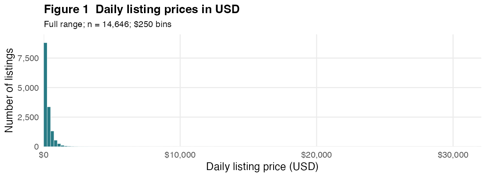
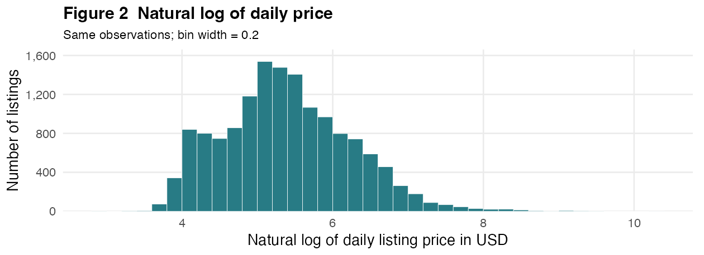
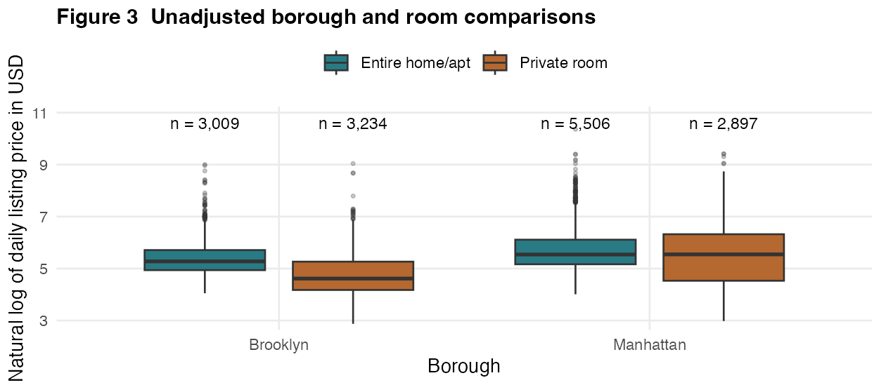
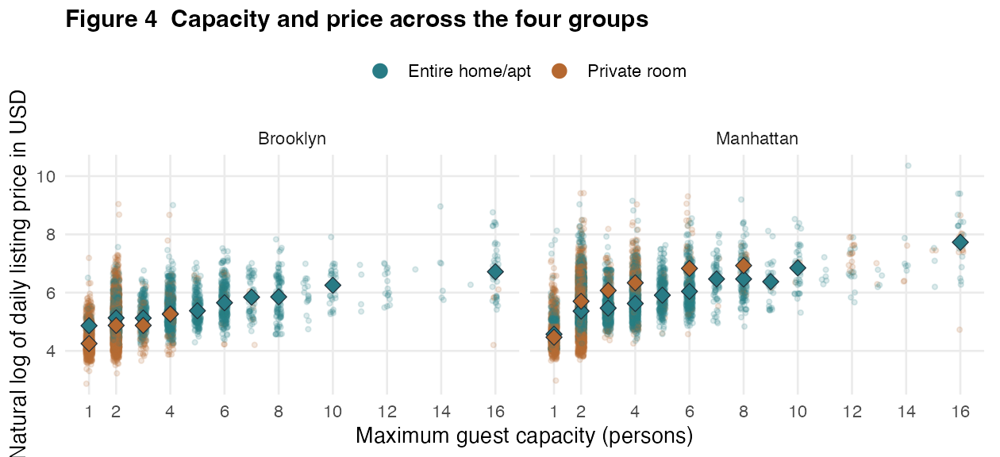
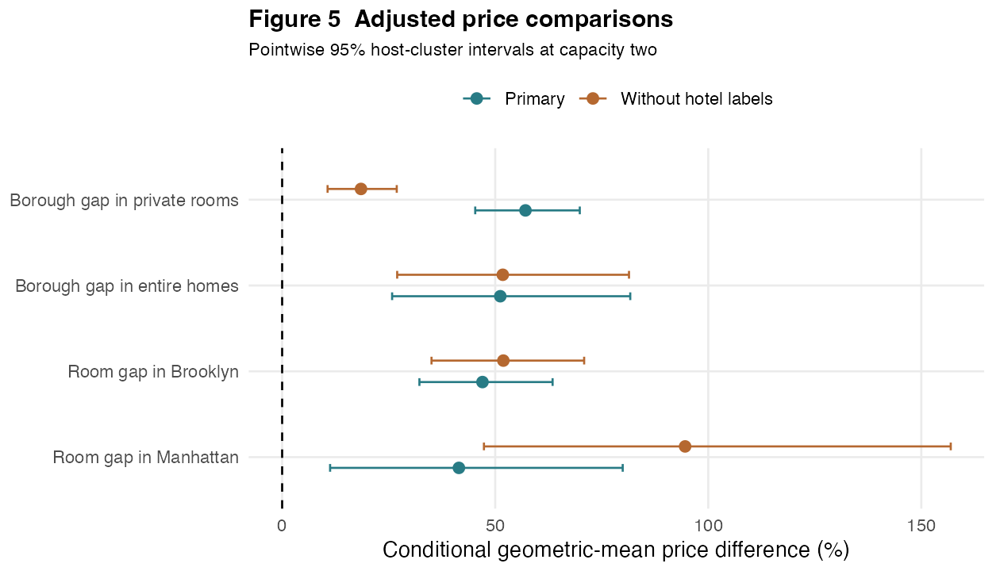
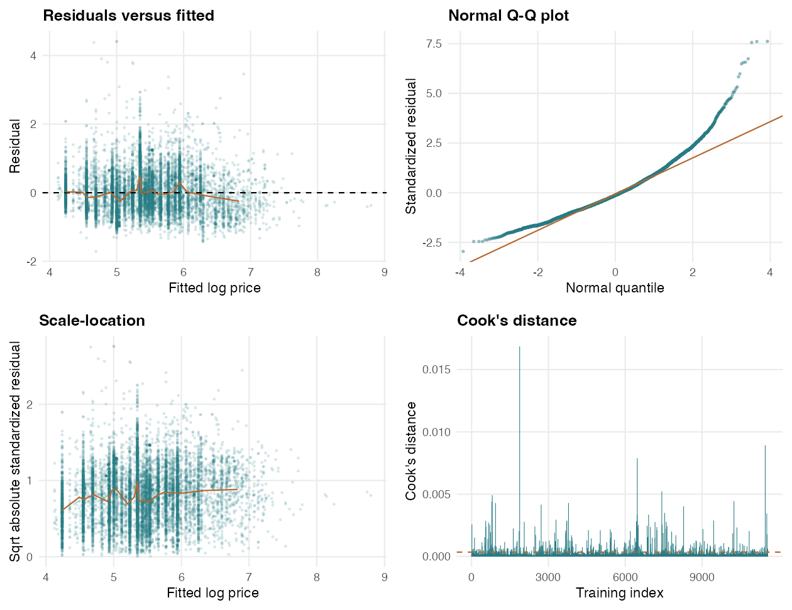
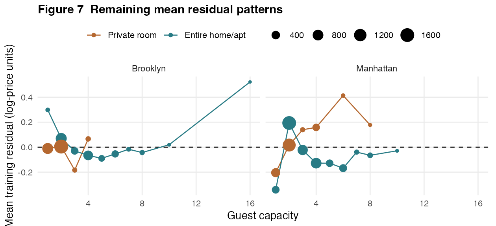

# Airbnb Listing Prices in Manhattan and Brooklyn

Final regression report | STAT GU4205/GR5205 | Fall 2026

Team members and UNIs: __________________________________________________

## Research objectives and main findings

We examine whether advertised Airbnb prices differ by borough and room type after adjustment for guest capacity, bedrooms and minimum-stay requirements. We ask whether borough differences persist within each room type, whether room-type differences persist within each borough, and whether the room-type association varies by borough. These are observational associations, not effects of changing a listing's location or room type.

The final working model finds positive adjusted borough and room-type differences, but weak evidence for the borough-by-room interaction in the primary sample (host-cluster p 0.669). The interaction evidence changes in the property-label sensitivity sample. Reserved-host log-price MSPR is 0.2881, compared with training residual MSE 0.3357. Remaining residual patterns and missing-price selection limit interpretation.

## Data collection and scope

We downloaded Inside Airbnb's NYC detailed-listings snapshot labeled 2026-09-14 on 2026-11-18 [1]. Its 29,918 unique listings and 90 fields were scraped from 2026-09-14 to 2026-09-15. Each row is a listing. We interpret price as the observed nightly USD amount, not a realized transaction or total trip cost [2].

The scope is Manhattan and Brooklyn, retaining Entire home/apt and Private room. Of 23,440 scoped records, 8,794 (37.5%) lack a price. The EDA includes all 14,646 finite positive-price records. Requiring complete valid core covariates and a known host leaves 14,616 model records. No arbitrary price cap, tail deletion or imputation is applied.

A direct audit finds that 14,645 of 14,646 EDA prices match price_quote_price_per_night at cent precision and have valid quote dates. Quoted stays of at least 30 nights account for 74.1% of EDA records. These are quote durations, distinct from minimum-stay requirements. The nightly amount may reflect requested dates, stay length and discounts; it is not a standardized one-night quote.

## Observed nightly price summaries

| Borough and room type | n | Median | Mean | SD |
| --- | --- | --- | --- | --- |
| Brooklyn entire home | 3,009 | $195.53 | $276.70 | $355.30 |
| Brooklyn private room | 3,234 | $101.01 | $164.17 | $256.33 |
| Manhattan entire home | 5,506 | $254.54 | $411.00 | $685.04 |
| Manhattan private room | 2,897 | $256.00 | $425.07 | $651.99 |

Source: fixed Inside Airbnb snapshot; positive-price EDA sample. These are unadjusted summaries. Sample composition and model eligibility are distinct from the EDA inclusion rule.

# Exploratory price distributions



Figure 1 retains the full range, from $17.70 to $31,537.82. The mean ($331.69) exceeds the median ($204.71), with a pronounced upper tail. The earlier exploratory report also provides a display zoom; extreme prices remain in the analysis.



Figure 2 uses the same records after taking natural logs. This compresses the upper tail and motivates examining proportional price differences. A more concentrated outcome histogram does not establish residual normality, linearity, constant variance or independence; those are assessed after fitting.

Figures 1 and 2: Inside Airbnb NYC 2026-09-14. All positive prices retained. Bin widths are stated in the panels; the change of horizontal scale changes the visual distribution, not the underlying observations.

# Room type and listing composition



Figure 3 shows overlapping unadjusted distributions. Manhattan medians are $256.00 for private rooms and $254.54 for entire homes; among listings requiring 30+ nights, they are $89.86 and $230.51. Minimum-stay composition therefore matters for interpretation.



Figure 3 boxes show medians and IQRs; whiskers extend up to 1.5 IQR. Figure 4 displays four variables: capacity, log price, room type and borough. All eligible records are plotted; fixed horizontal jitter changes only display positions. Diamonds are medians for cells with at least 20 records. Source: Inside Airbnb NYC 2026-09-14.

Capacity distributions differ, and high-capacity private rooms are sparse. In Manhattan, 1,304 of 2,897 private-room listings (45.0%) have hotel/hostel/resort text in property_type. This motivates a prespecified sensitivity analysis; Private room itself remains included.

# Final statistical model

We fit M3 by ordinary least squares to 11,568 saved training records from 5,564 hosts. The variables below define the response, predictors and host grouping. Ratings are omitted to avoid restricting the sample to reviewed listings.

| Variable | Definition and role |
| --- | --- |
| price / log_price | Observed nightly USD amount / its natural logarithm; log_price is the response. |
| borough | Brooklyn (reference) or Manhattan; categorical location predictor. |
| room_type | Private room (reference) or Entire home/apt; categorical room predictor. |
| log_accommodates | Natural log of maximum guest capacity; listing-size predictor. |
| bedrooms | Number of bedrooms, entered linearly; a reported zero is retained. |
| long_stay | 1 if minimum_nights >= 30; 0 otherwise. This describes the requirement, not actual stay length. |
| within_stay_log_min | log(minimum_nights) minus the training mean within the corresponding long_stay group. |
| host_id | Host identifier for splitting and clustered uncertainty; not a regression predictor. |

```
log_price ~ borough * room_type + log_accommodates + bedrooms +
  within_stay_log_min + long_stay
```

The training means used for centering are 0.3147 below 30 nights and 3.4262 at 30+ nights. Centering reparameterizes the stay terms without changing fitted values. The long_stay coefficient compares these group-specific centers, not a discontinuity at 30 nights or the effect of extending a stay requirement.

## R summary output

```

Call:
lm(formula = as.formula(refinement_formula), data = train3, na.action = na.fail)

Residuals:
    Min      1Q  Median      3Q     Max
-1.7109 -0.3971 -0.0728  0.3153  4.4129

Coefficients:
                                           Estimate Std. Error t value Pr(>|t|)
(Intercept)                                5.039857   0.017030 295.946  < 2e-16 ***
boroughManhattan                           0.451737   0.016971  26.618  < 2e-16 ***
room_typeEntire home/apt                   0.385362   0.018408  20.935  < 2e-16 ***
log_accommodates                           0.449042   0.012828  35.005  < 2e-16 ***
bedrooms                                   0.112506   0.006746  16.678  < 2e-16 ***
within_stay_log_min                       -0.083317   0.016404  -5.079 3.85e-07 ***
long_stay                                 -0.914670   0.013433 -68.090  < 2e-16 ***
boroughManhattan:room_typeEntire home/apt -0.038346   0.022661  -1.692   0.0907 .
---
Signif. codes:  0 ‘***’ 0.001 ‘**’ 0.01 ‘*’ 0.05 ‘.’ 0.1 ‘ ’ 1

Residual standard error: 0.5794 on 11560 degrees of freedom
Multiple R-squared:  0.5459,	Adjusted R-squared:  0.5456
F-statistic:  1985 on 7 and 11560 DF,  p-value: < 2.2e-16
```

This R summary reports ordinary independent-error standard errors and tests. The main inference on the next page instead uses host-cluster HC1 covariance [3], since a host can contribute multiple listings. The coefficient estimates are unchanged; their uncertainty estimates differ.

The borough-by-room interaction permits different room contrasts across boroughs. exp(a log contrast) is a fitted conditional geometric-mean ratio; it is not an arithmetic-mean dollar ratio unless additional distributional assumptions are made.

# Research questions and adjusted comparisons

Inference uses 5,564 training hosts and sandwich::vcovCL(type='HC1', cadjust=TRUE). Contrast intervals use t with G-1 degrees of freedom; joint Wald tests use approximate F(q, G-1). These allow within-host dependence and heterogeneous variances, assuming independent hosts and appropriate regularity conditions [3]. They do not repair mean misspecification or dependence between different hosts.

## Conditional comparisons in the primary sample

| Comparison | Difference | Pointwise 95% CI | Holm p |
| --- | --- | --- | --- |
| Borough gap in private rooms | 57.1% | 45.3% to 69.9% | <0.001 |
| Borough gap in entire homes | 51.2% | 25.8% to 81.7% | <0.001 |
| Room gap in Brooklyn | 47.0% | 32.2% to 63.5% | <0.001 |
| Room gap in Manhattan | 41.5% | 11.3% to 79.9% | 0.00467 |

Borough gaps compare Manhattan with Brooklyn. Room gaps compare Entire home/apt with Private room. Differences are percentages of fitted conditional geometric means at common covariates. Four contrast p-values form one Holm family. Intervals are pointwise, not simultaneous.

## Joint research question tests

| Null hypothesis | F statistic | df1, df2 | Holm p |
| --- | --- | --- | --- |
| Borough main effect and interaction = 0 | 64.841 | 2, 5,563 | <0.001 |
| Room main effect and interaction = 0 | 32.399 | 2, 5,563 | <0.001 |
| Borough by room interaction = 0 | 0.183 | 1, 5,563 | 0.669 |

The joint borough and room-type hypotheses are rejected in this working model. The borough-by-room interaction is not clearly supported (p 0.669). This does not prove an exactly zero interaction. With an interaction present, the borough main coefficient describes private rooms, and the room main coefficient describes Brooklyn; comparisons in the other group require adding the interaction coefficient.

The three joint tests form a separate Holm family. Neither family adjustment nor the pointwise intervals accounts for training-data-driven functional-form selection or inspection across specifications. Interpret these inferential results as exploratory. Tests from the ordinary R summary are provided for transparency, not substituted for host-cluster inference.

The four estimated differences range from 41.5% to 57.1%. Positive fitted associations persist after the included controls, but omitted neighborhood, amenities and property quality can still explain part of those differences. The model is a parsimonious association summary, not an experiment.

# Sensitivity to property labels

The sensitivity sample excludes property_type text matching hotel|hostel|resort, case-insensitively, and unknown property labels. It uses the same final formula and inherited host split, with 10,393 training listings from 5,327 hosts. Both room types remain included. This is a label-based subset, not a verified residential or legal classification.



Figure 5 shows a substantial change in the private-room borough contrast: 57.1% in the primary sample versus 18.5% in the subset. The Manhattan room contrast changes from 41.5% to 94.6%. The borough-by-room interaction has cluster p 0.0134 in the subset, compared with 0.669 in the primary sample.

These analyses answer questions about different populations. A significant result in one sample and a nonsignificant result in another does not establish a statistically significant difference between the estimates; no such difference test was performed. We report both and do not choose the sample to obtain significance.

Figure 5 uses training estimates and pointwise 95% intervals; model-selection uncertainty is not included. Source: Inside Airbnb NYC 2026-09-14. Under M3 the four contrasts are constant over the modeled capacity range; showing capacity two anchors interpretation without proving validity outside supported profiles.

# Appendix A Model selection and support

| Model | p | Adj R2 | Train MSE | CV listing | CV host |
| --- | --- | --- | --- | --- | --- |
| M0 | 3 | 0.159 | 0.6212 | 0.6346 | 0.5287 |
| M1 | 7 | 0.532 | 0.3456 | 0.3620 | 0.3026 |
| M2 | 8 | 0.533 | 0.3454 | 0.3634 | 0.3034 |
| M3 | 8 | 0.546 | 0.3357 | 0.3532 | 0.2978 |
| M4 | 9 | 0.550 | 0.3323 | 0.3527 | 0.2953 |

All models use identical primary training records. CV listing pools listing errors; CV host gives each validation host equal weight. All errors are on the natural-log-price scale. p includes the intercept.

All candidates model log price: the right tail in Figures 1-2 motivates a proportional-price scale, without establishing normal residuals. M0 gives the borough and room-type baseline. M1 adds capacity and bedrooms to account for listing size, plus log minimum nights and long_stay to distinguish stay requirements across listings.

M2 adds the planned borough-by-room interaction to test whether room contrasts differ by borough. It remains in M3 despite weak primary-sample interaction evidence.

M3 uses log capacity because M2 residual-versus-capacity plots showed nonlinear mean patterns. Centering log minimum nights within stay groups changes interpretation and collinearity measures, not fitted values. Both saved-fold CV scores improve over M2. The Q-Q and scale-location plots still show tail and spread problems (Figure 6).

M4 tests room-specific log-capacity slopes, motivated by the group-capacity residual patterns remaining under M3 (Figure 7).

Five folds separate training hosts, using the original saved folds. Preprocessing is learned inside each fold. M4 improves listing-weighted CV MSE by 0.128% and equal-host CV MSE by 0.844% versus M3. The rule recorded before fitting M4 required at least 1% improvement in both, so M3 is retained for parsimony. This threshold is a practical choice, not a test of predictive superiority.

Diagnostic-driven refinement limits the independence of these CV comparisons. The final coefficients, preprocessing and prediction rule were recorded before reserved-host errors were calculated; test scores did not select M3.

## Training support at capacity two and one bedroom

| Borough and room type | Minimum stay below 30 | Minimum stay 30 or more |
| --- | --- | --- |
| Brooklyn entire home | 85 | 535 |
| Brooklyn private room | 515 | 933 |
| Manhattan entire home | 103 | 971 |
| Manhattan private room | 704 | 531 |

Across all capacities and bedrooms, 5 joint capacity-bedroom-stay cells contain at least 20 records in every group, covering 58.2% of training listings. This check supports common profiles but not every combination. Exact minimum-night overlap and unobserved characteristics are not guaranteed.

# Appendix B Model diagnostics



Figure 6. Final M3 training diagnostics, Inside Airbnb NYC 2026-09-14. Orange residual and scale-location lines show means in 20 fitted-value bins; the Q-Q line uses the first and third quartiles. The Cook threshold is 4/n, a screening rule rather than an automatic deletion criterion.

The Q-Q plot has a pronounced upper tail and the scale-location plot shows unequal spread. Mean residual patterns remain at some fitted values and capacities. Logging the response and capacity improves interpretability and some fit features, but does not make all classical assumptions hold. Host-cluster covariance addresses uncertainty from some dependence and heteroskedasticity, not systematic mean errors.

The largest design-column VIF is 4.09, compared with 18.47 in the earlier M2. Much of the reduction comes from equivalent within-regime centering, not an increase in information. There are 510 Cook flags, 610 leverage flags above 2p/n, and 114 absolute externally studentized residuals above 3. No record is automatically removed.

# Appendix C Validation and influence

A fixed host split reserved 3,048 listings from 1,391 hosts; no host overlaps training. The frozen M3 predicts these records without refitting or re-centering. Earlier EDA viewed the full snapshot, so this is a prospective holdout for later modeling, not untouched external validation. All inferential estimates in this report remain training estimates.

| Quantity | Definition | Value |
| --- | --- | --- |
| Training residual MSE | RSS / (n - p) | 0.3357 |
| Reserved-host MSPR | Mean squared prediction error | 0.2881 |
| Reserved-host RMSE | Square root of MSPR | 0.5367 |
| Training-mean benchmark MSPR | Predict training mean log price | 0.6400 |

Test MSPR is 0.858 times training MSE and 55.0% below the constant benchmark. A lower test error can reflect sample composition and sampling variation; it does not prove the absence of overfitting or validate all assumptions. Equal-host test MSPR is 0.3201. We made no model changes in response to these scores.

| Test group | n | MSPR | Mean residual |
| --- | --- | --- | --- |
| Brooklyn private room | 547 | 0.2697 | 0.0323 |
| Manhattan private room | 595 | 0.4074 | 0.0044 |
| Brooklyn entire home | 612 | 0.2719 | 0.0299 |
| Manhattan entire home | 1,294 | 0.2486 | -0.0933 |

Residual = observed minus predicted log price. Group errors are descriptive; group host counts would not sum to unique hosts because a host can list in multiple groups.

## Influence of listings and hosts

Deleting the largest-Cook record changes any primary log contrast by at most 0.0017. Deleting each of the ten largest hosts separately changes one by up to 0.1066; the largest host has 292 training listings. All primary records are retained. These limited deletion checks show host concentration matters and are not exhaustive robustness validation.

| Contrast | Primary log gap | Range after one host deletion |
| --- | --- | --- |
| Borough gap in private rooms | 0.4517 | 0.4404 to 0.4616 |
| Borough gap in entire homes | 0.4134 | 0.3239 to 0.4472 |
| Room gap in Brooklyn | 0.3854 | 0.3570 to 0.4236 |
| Room gap in Manhattan | 0.3470 | 0.2405 to 0.4092 |

# Limitations and conclusions



Figure 7. Point area represents cell n. Training group-capacity cells with n >= 20 are shown; smaller cells remain in the model. Residual patterns persist despite the diagnostic-driven checks. Source: Inside Airbnb NYC 2026-09-14.

The observed-price sample is selected: missingness differs across groups and observed characteristics. A single snapshot mixes stay requirements and property types and does not identify realized bookings. Omitted amenities, quality and neighborhood differences can confound associations. Repeated-host adjustment does not account for all cross-host or spatial dependence. Sparse covariate combinations, residual mean patterns and model-selection uncertainty limit nominal tests and intervals.

Within the final working model, Manhattan and entire-home listings have higher adjusted geometric-mean prices than their comparison groups. Evidence that the room-type association differs by borough is weak in the primary sample and sensitive to property-label exclusions. The reserved evaluation shows improvement over a constant prediction, while group errors and influence checks discourage treating the model as a precise market-wide pricing rule.

## References and reproducibility

[1] Inside Airbnb. New York City detailed listings, snapshot 2026-09-14. Retrieved 2026-11-18. CC BY 4.0. https://insideairbnb.com/get-the-data/

[2] Inside Airbnb. Data Dictionary, detailed listings, version 4.3 (August 2022), linked from the source download page. https://docs.google.com/spreadsheets/d/1iWCNJcSutYqpULSQHlNyGInUvHg2BoUGoNRIGa6Szc4/edit

[3] sandwich package. Clustered Covariance Matrix Estimation, vcovCL documentation. https://sandwich.r-forge.r-project.org/reference/vcovCL.html

[4] Inside Airbnb. Data Assumptions. https://insideairbnb.com/data-assumptions/

Data are a snapshot of public listings [4]. The separately submitted Airbnb_Project.R downloads the fixed data and regenerates the analysis, figures, tables, quote audit and report text. Run the whole file in RStudio or with Rscript --vanilla Airbnb_Project.R; no other project files are needed. The development repository additionally provides PDF/Word rendering scripts.
