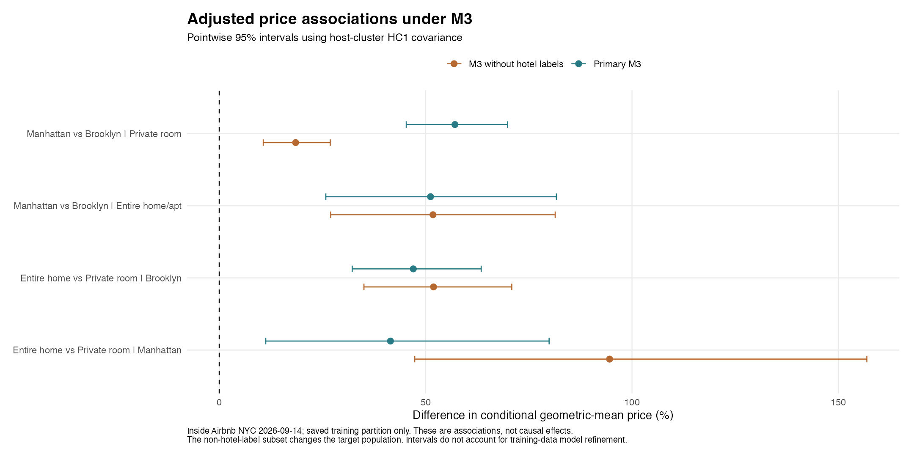
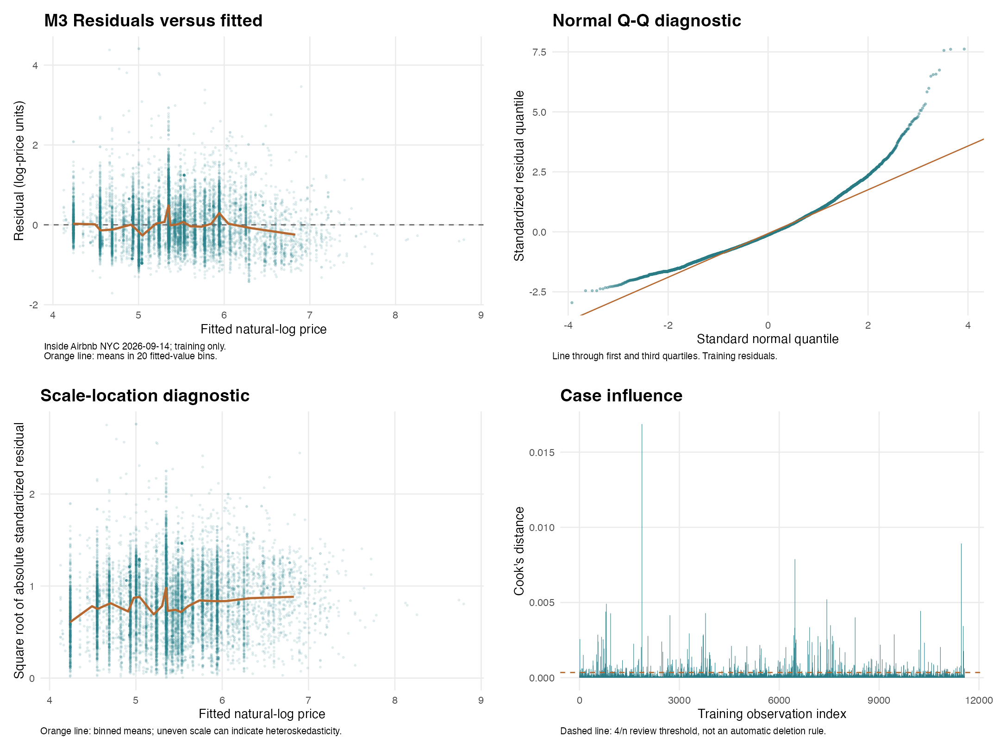
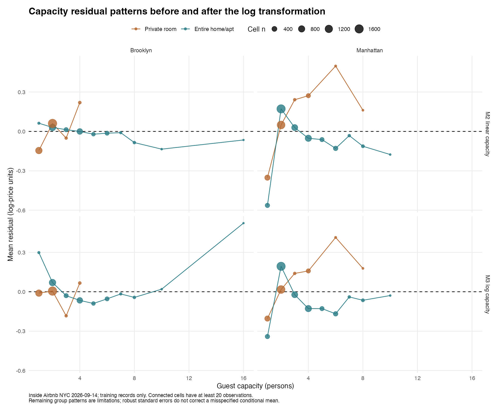

# Training regression analysis — working results

Generated by scripts/12_training_report.R from the pinned Inside Airbnb NYC 2026-09-14 snapshot. This is a modeling-stage report, not the final course submission.

## Status and sample

The primary training analysis uses 11,568 listings from 5,564 hosts. Both Private room and Entire home/apt remain included in Manhattan and Brooklyn. The property-label sensitivity uses 10,393 training listings from 5,327 hosts.

The saved host-level test partition has not been scored. Training and testing hosts are disjoint; the sensitivity subset inherits the same split. Earlier EDA examined the full snapshot, so this is a prospective holdout for subsequent modeling, not pristine external validation. Missing-price listings remain excluded without imputation; observed-price associations need not describe the entire NYC market.

## Model sequence and diagnostic-driven revision

The response is natural-log listing price. Brooklyn and Private room are reference levels. Ratings are omitted from the core model to avoid selecting only reviewed listings. M0 contains borough and room type; M1 adds capacity, bedrooms, log minimum nights and a 30-or-more-night indicator; M2 adds borough-by-room-type interaction.

M2 diagnostic plots motivated one documented refinement, M3: use log guest capacity rather than linear capacity. Also center log minimum nights within the two minimum-stay regimes, using training means only. Centering is an algebraically equivalent reparameterization of the stay terms; it does not improve predictions by itself, create additional information, or solve weak support within a regime. The same number of coefficients is retained. The capacity transformation is the substantive model-form change.

```r
log_price ~ borough * room_type + log_accommodates + bedrooms + within_stay_log_min + long_stay
```

Here within_stay_log_min = log(minimum_nights) minus its training mean in the same long_stay group; long_stay = 1 when minimum_nights >= 30. The indicator coefficient is therefore a contrast at the two group-specific centering values, not a discontinuity at 30 nights. Saved centering values must be reused for future prediction.

Model comparison uses 5-fold validation within the training hosts, with seed 20261119. Every listing from a host shares a fold, and the stay centers are relearned inside each fold. Scores are mean squared errors in log-price units; smaller is better. These are exploratory comparisons because the M3 idea came from the same training data, not an independent assessment of the entire selection process.

- M0: adjusted R-squared 0.159; training residual MSE 0.621; host-fold CV MSE 0.635 (listing weighted), 0.529 (equal host weighted).
- M1: adjusted R-squared 0.532; training residual MSE 0.346; host-fold CV MSE 0.362 (listing weighted), 0.303 (equal host weighted).
- M2: adjusted R-squared 0.533; training residual MSE 0.345; host-fold CV MSE 0.363 (listing weighted), 0.303 (equal host weighted).
- M3: adjusted R-squared 0.546; training residual MSE 0.336; host-fold CV MSE 0.353 (listing weighted), 0.298 (equal host weighted).

M3 reduces pooled validation MSE by 2.8% relative to M2. It has the lowest observed CV error among these candidates and is the current working specification. This small improvement is descriptive, not a statistical test of predictive superiority. We retain the interaction to address the prespecified third question and conditional comparisons, not because its primary-sample p-value is small.

See [candidate metrics](refined_candidate_metrics.csv), [fold-level errors](training_host_CV_by_fold.csv), and [M3 R summary](M3_R_summary.txt). Classical AIC, BIC and nested F output are supplied as familiar supporting output; they rely on working independent-error likelihood assumptions and are not the main evidence when hosts repeat.

## Dependence and inference

There are 1,331 training hosts with multiple listings, covering 7,335 records; the largest host contributes 292 records. Ordinary independent-error uncertainty estimates can differ substantially from host-cluster estimates. In M2, the interaction has ordinary p 0.00432 versus host-cluster p 0.488. Under M3, its host-cluster p is 0.669; this does not demonstrate that the interaction is exactly zero.

Inference uses sandwich::vcovCL with host clusters, type='HC1', cadjust=TRUE. Individual/contrast intervals use a t reference with G-1 degrees of freedom; joint Wald statistics use an approximate F(q, G-1) reference. These are large-sample approximations, not exact small-sample tests. They allow within-host error dependence and heterogeneous variances under regularity conditions, while assuming independent hosts. They do not repair an incorrect conditional mean, neighborhood-level dependence across hosts, selection from missing prices, or omitted variables. See the [official vcovCL documentation](https://sandwich.r-forge.r-project.org/reference/vcovCL.html).

The four planned conditional contrasts form one Holm-adjusted p-value family within each sample; the three research-question tests form a separate family. Intervals are pointwise 95%, not simultaneous. Neither these intervals nor p-values account for diagnostic-driven model refinement or comparisons across specifications/samples, so they are exploratory inference.

## Conditional comparisons under M3

Percentages are 100 × (exp(log contrast) - 1), comparing fitted conditional geometric-mean prices at the same modeled covariates. They are not arithmetic-mean dollar differences or causal effects. The common slope form assumes these contrasts are constant across capacity, bedrooms and stay conditions; sparse covariate combinations can require extrapolation.

- Manhattan vs Brooklyn | Private room: 57.1% (pointwise 95% interval 45.3% to 69.9%); Holm-adjusted p <0.001.
- Manhattan vs Brooklyn | Entire home/apt: 51.2% (pointwise 95% interval 25.8% to 81.7%); Holm-adjusted p <0.001.
- Entire home vs Private room | Brooklyn: 47.0% (pointwise 95% interval 32.2% to 63.5%); Holm-adjusted p <0.001.
- Entire home vs Private room | Manhattan: 41.5% (pointwise 95% interval 11.3% to 79.9%); Holm-adjusted p 0.00467.



## Research questions and sensitivity

- Primary M3 / No borough association at either room type: approximate F(2, 5,563) = 64.841; p <0.001; Holm-adjusted p <0.001.
- Primary M3 / No room-type association in either borough: approximate F(2, 5,563) = 32.399; p <0.001; Holm-adjusted p <0.001.
- Primary M3 / No borough by room-type interaction: approximate F(1, 5,563) = 0.183; p 0.669; Holm-adjusted p 0.669.
- M3 without hotel labels / No borough association at either room type: approximate F(2, 5,326) = 24.322; p <0.001; Holm-adjusted p <0.001.
- M3 without hotel labels / No room-type association in either borough: approximate F(2, 5,326) = 25.473; p <0.001; Holm-adjusted p <0.001.
- M3 without hotel labels / No borough by room-type interaction: approximate F(1, 5,326) = 6.125; p 0.0134; Holm-adjusted p 0.0134.

The primary working model provides evidence of adjusted borough and room-type associations, but not clear evidence that the room-type association varies by borough. The joint borough test sets both the borough main effect and interaction to zero; the joint room-type test sets both the room main effect and interaction to zero. Thus these tests do not mistake a reference-group coefficient for an overall association.

The prespecified sensitivity excludes property_type text matching hotel|hostel|resort and unknown property-type labels. It still contains Private room listings and is not a verified legal or residential classification. It changes the target population, so a different result is not evidence that one sample is correct or that the two effects differ statistically.

- Manhattan vs Brooklyn | Private room: 18.5% (pointwise 95% interval 10.7% to 26.9%); Holm-adjusted p <0.001.
- Manhattan vs Brooklyn | Entire home/apt: 51.8% (pointwise 95% interval 27.0% to 81.4%); Holm-adjusted p <0.001.
- Entire home vs Private room | Brooklyn: 51.9% (pointwise 95% interval 35.1% to 70.9%); Holm-adjusted p <0.001.
- Entire home vs Private room | Manhattan: 94.6% (pointwise 95% interval 47.4% to 156.9%); Holm-adjusted p <0.001.

The interaction evidence and private-room borough contrast are sensitive to this population definition. Report both analyses; do not select the sample because it produces the desired significance. A formal difference-between-samples test has not been conducted.

## Diagnostic findings and influence





Residual Q-Q plots show pronounced upper-tail departures; scale-location plots show unequal residual spread. Group residual means still vary with capacity, even after the log transformation. M3 improves aggregate validation error but does not fully resolve functional-form limitations. Classical Gaussian/constant-variance assumptions should not be declared satisfied. Cluster covariance addresses part of the uncertainty problem, not these remaining mean patterns.

The maximum design-column VIF falls from 18.47 in M2 to 4.09 in M3. Much of the change reflects within-regime centering of stay terms, not evidence that information about their separate effects increased.

M3 has 510 records above the Cook screening rule 4/n and 114 with absolute externally studentized residual above 3; maximum Cook distance is 0.0169. These are review flags, not automatic exclusion rules. No record was removed from the main model on this basis.

Dropping the single largest-Cook record changes the four log contrasts by at most 0.0017. Dropping the largest host changes them by at most 0.1066, equivalent to a multiplicative change in a fitted contrast ratio of up to 11.2%. Host-level concentration therefore deserves more attention than a single influential listing. These deletion fits are diagnostic only; neither replaces the primary analysis. See the exact [influence checks](M3_influence_checks.csv).

## Remaining work before final submission

1. Review whether the working functional form and remaining group patterns are acceptable for the course's inferential aim; document any further justified revision using training data only, then freeze the specification and prediction rule.
2. Evaluate that frozen model once on the reserved hosts. Report test MSPR = mean((observed log price - predicted log price)^2) alongside training residual MSE = RSS/(n-p). Do not tune the model in response to the test score. Dollar-scale prediction requires a separately justified retransformation rule; exponentiation alone does not predict arithmetic-mean price.
3. Integrate focused EDA, model summary, tests, diagnostics, influence and limitations into the approximately ten-page final report, with code submitted separately. The earlier five-page Project Description remains the initial proposal-stage artifact.
4. Supply the real team names/UNIs and review instructor announcements and any additional classroom requirements.

## Reproduce

```sh
Rscript --vanilla scripts/setup_model_dependencies.R
Rscript --vanilla scripts/12_training_report.R
Rscript --vanilla scripts/13_verify_training.R
```

R performs every calculation and creates all six modeling figures. Raw/processed row-level data, fitted-object caches and local package libraries are excluded from Git. CSV results and figures are regenerated; do not edit them by hand.
