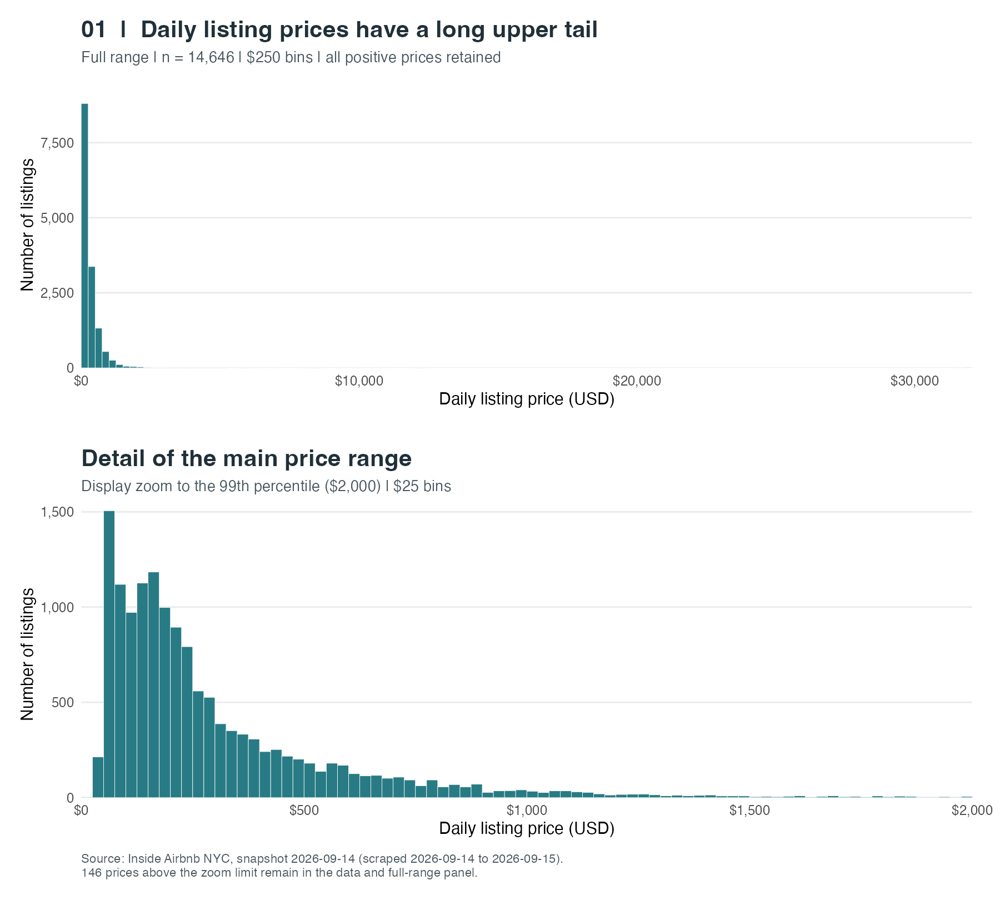
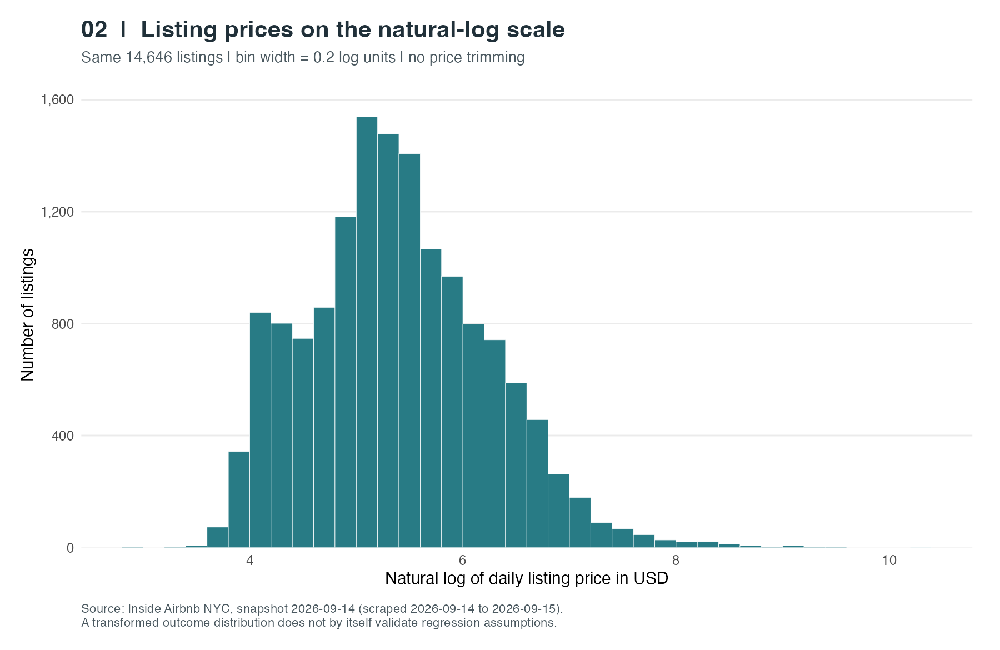
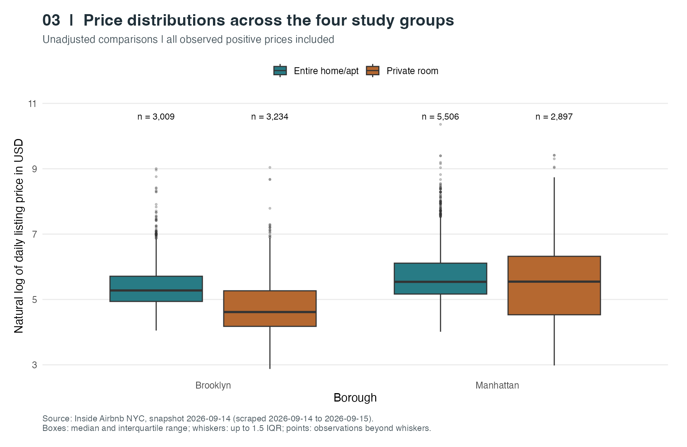
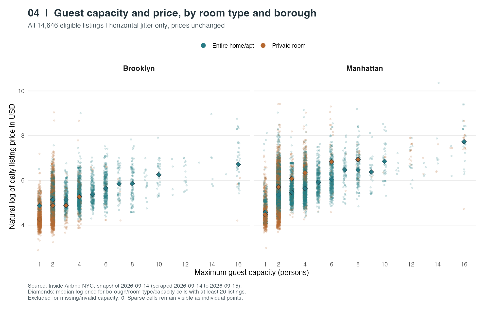

# Airbnb Listing Prices in Manhattan and Brooklyn

Project Description | STAT GU4205/GR5205 | Fall 2026

Team members and UNIs: __________________________________________________

## Study objectives

We study whether Airbnb listing prices differ between Manhattan and Brooklyn and between Entire home/apt and Private room after accounting for observed listing characteristics. This observational study focuses on associations rather than causal effects. Our exploratory results highlight differences in minimum-stay requirements and property types that must be considered when interpreting price comparisons.

1. Do adjusted borough price differences persist within each room type?
2. Do adjusted room-type price differences persist within each borough?
3. Does the room-type association vary by borough, as represented by an interaction?

## Data source and analytical sample

We use Inside Airbnb's detailed NYC listings snapshot labeled 2026-09-14, downloaded for this project on 2026-11-18 [1]. Actual listing scrape dates run from 2026-09-14 to 2026-09-15. The raw file has 29,918 unique listings and 90 fields. Each row represents a listing; price is the advertised daily price in local currency, interpreted as USD for NYC, not a realized transaction price [2].

Restricting the data to the two boroughs and two room types yields 23,440 listings. Of these, 8,794 (37.5%) lack a price. We retain all 14,646 finite positive-price listings for exploratory analysis. No price-tail trimming, imputation or random subsampling is applied; missing covariates do not remove records from these price summaries.

## Daily price summaries in USD

| Borough and room type | n | Median | Mean | SD | Q1 to Q3 |
| --- | --- | --- | --- | --- | --- |
| Brooklyn Entire home/apt | 3,009 | $195.53 | $276.70 | $355.30 | $139.67 to $302.13 |
| Brooklyn Private room | 3,234 | $101.01 | $164.17 | $256.33 | $65.13 to $193.54 |
| Manhattan Entire home/apt | 5,506 | $254.54 | $411.00 | $685.04 | $175.13 to $450.71 |
| Manhattan Private room | 2,897 | $256.00 | $425.07 | $651.99 | $92.88 to $556.10 |

Q1 and Q3 are the 25th and 75th percentiles. These comparisons are unadjusted. All statistics and figures are generated from the fixed source file by the accompanying R scripts.

# Raw price distribution

Across the exploratory sample, the mean daily price is $331.69 and the median is $204.70. Prices range from $17.70 to $31,537.82, indicating a long upper tail that deserves attention in model diagnostics.

Figure 1 shows the full price range and a separate display zoom ending at the sample 99th percentile, $2,000.00. The 146 observations above this value remain in the dataset and the full-range panel. The panels use different, labeled bin widths. High prices alone are not sufficient grounds for deleting observations; their plausibility and influence will be examined later.

# Price transformation and listing characteristics

Figure 2 uses the same observations on the natural-log price scale. The transformation compresses the upper tail and makes the main distribution easier to inspect. We will examine a log-price regression, but the appearance of the outcome histogram does not establish linearity, constant residual variance, residual normality or independence.

## Observed covariates in the exploratory sample

| Variable | Observed n | Missing n | Median | Q1 | Q3 |
| --- | --- | --- | --- | --- | --- |
| Guest capacity | 14,646 | 0 | 2.00 | 2.00 | 4.00 |
| Bedrooms | 14,622 | 24 | 1.00 | 1.00 | 2.00 |
| Minimum nights | 14,640 | 6 | 30.00 | 5.00 | 30.00 |
| Review score | 10,775 | 3,871 | 4.85 | 4.65 | 5.00 |

Capacity and bedrooms describe listing size, while minimum nights captures stay requirements. Review scores have substantial missingness and are not required in the planned core model. Missing bedrooms are not recoded as zero; a reported zero-bedroom listing is retained as a possible studio. Repeated listings from the same host will also be considered when evaluating dependence.

# Borough and room type comparisons

Figure 3 compares unadjusted distributions. In Manhattan, median price is $256.00 for private rooms and $254.54 for entire homes. Among listings requiring at least 30 nights, the corresponding medians are $89.86 and $230.51. This change motivates accounting for stay requirements; it is not a causal decomposition.

| Borough and room type | Price coverage | Minimum stay 30+ | Hotel like label |
| --- | --- | --- | --- |
| Brooklyn Entire home/apt | 56.6% | 86.7% | 0.1% |
| Brooklyn Private room | 66.6% | 69.9% | 3.1% |
| Manhattan Entire home/apt | 61.7% | 83.9% | 1.1% |
| Manhattan Private room | 66.6% | 46.9% | 45.0% |

Price coverage uses all scoped listings in that group. The other percentages use positive-price listings, including records with missing minimum stay in their denominators. Hotel like label means property_type contains hotel, hostel or resort, case-insensitively; it is not a verified business or legal classification.

Within Manhattan private rooms, 1,304 of 2,897 listings (45.0%) meet that label rule. We retain them in the primary scope and plan one sensitivity analysis excluding those labels and unknown property types. Private room itself is retained in both analyses.

# Capacity relationships and planned analysis

Figure 4 represents guest capacity, log price, room type and borough in one graphic. Brooklyn: median capacity is 4 for entire homes and 2 for private rooms; Manhattan: median capacity is 3 for entire homes and 2 for private rooms. Differences in capacity distributions motivate adjustment for listing size. All 14,646 eligible listings are plotted; median markers require at least 20 observations per cell. Sparse high-capacity cells should not support broad extrapolation.

## Planned regression and validation

Our starting specification models log price using borough, room type, their interaction, capacity, bedrooms, log minimum nights and an indicator for minimum stays of at least 30 nights. The complete-core-covariate sample with known host IDs contains 14,616 listings. The non-hotel-label sensitivity sample contains 13,155. We will compare the same adjusted contrasts and confidence intervals using the same model form.

A fixed host-level split assigns approximately 80% of hosts to training and the remainder to testing; all listings from one host stay together. Earlier EDA used the full snapshot, so the test subset is reserved prospectively for model evaluation, not an untouched external dataset. Model decisions and diagnostics will use training data. Later work will examine residuals, collinearity, influential observations and host dependence, and compare held-out MSPR with training residual MSE on the log-price scale. No regression has been fitted at this stage.

Limitations include missing-price selection, differing property/stay composition, unmeasured listing characteristics and a single observational snapshot. Results will describe adjusted associations within the chosen sample, not causal effects or all NYC accommodation [3].

## References

[1] Inside Airbnb. New York City detailed listings, 2026-09-14. CC BY 4.0. https://insideairbnb.com/get-the-data/

[2] Inside Airbnb. Data Dictionary for detailed listings. Linked from the data download page. Variables follow the source definitions; newer quote fields are not used to fill missing prices.

[3] Inside Airbnb. Data Assumptions. https://insideairbnb.com/data-assumptions/
